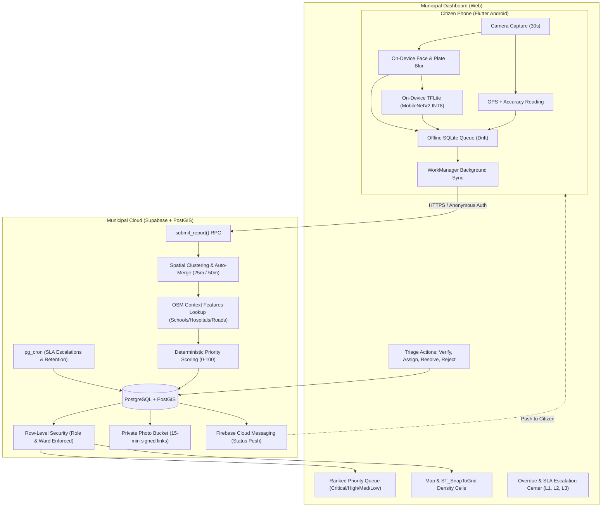

# CivicSync 🚦

> **Fast, explainable municipal road hazard reporting and triage platform.**  
> Built for the DTU-SEVA / RYIC innovation challenge. Designed for pilot deployment across Agra and Jodhpur.

CivicSync bridges citizens and municipal corporations to repair roads faster:
1. **Citizens (Mobile)** photograph hazards in under 30 seconds. The app tags exact GPS location, infers hazard type offline via an on-device lightweight TensorFlow Lite model, blurs faces and license plates on-device for privacy, and syncs reliably even in poor connectivity.
2. **Municipal Cloud (Supabase / PostGIS)** ingests reports, clusters duplicate reports at 25m–50m thresholds with advisory concurrency locks, computes a transparent Priority Score (0–100) based on hazard type, size, model confidence, corroboration, and OpenStreetMap spatial context (proximity to schools, hospitals, primary arteries), and manages SLAs.
3. **Municipal Dashboard (Web)** empowers Ward Officers, Crew Leads, Zonal Engineers, and City Admins with a ranked priority queue, density clustering maps, duplicate merge/split review, and one-click status transitions (`Reported` → `Verified` → `Assigned` → `Resolved`).

---

## 🏛️ System Architecture



---

## 📂 Repository Layout

```text
civicsync/
├── apps/
│   ├── citizen_app/             # Flutter Android/iOS mobile application
│   │   ├── lib/
│   │   │   ├── core/            # Theme, router, localization (EN / HI)
│   │   │   ├── data/            # Drift SQLite database, models, sync engine
│   │   │   ├── services/        # Camera, GPS, TFLite inference, privacy blur
│   │   │   └── presentation/    # Capture screen, preview, triage, my reports
│   │   └── pubspec.yaml
│   └── dashboard/               # Municipal Web Dashboard
│       ├── public/              # Static assets & entry points
│       ├── src/                 # Reactive dashboard UI (Queue, Map, Triage, SLAs)
│       └── package.json
├── supabase/
│   ├── migrations/              # PostGIS schemas, RLS policies, RPC functions
│   │   ├── 20261029000000_initial_schema.sql
│   │   └── 20261029000001_seed_pilot_data.sql
│   └── tests/                   # SQL and pgTAP unit tests for RLS & scoring
├── ml/
│   ├── models/                  # MobileNetV2 architecture & export definitions
│   ├── dataset.py               # RDD2022 dataset preparation & class balancing
│   ├── train.py                 # Keras transfer learning pipeline
│   ├── quantize.py              # Post-training INT8 quantization to .tflite
│   └── evaluate.py              # Benchmark script (Top-1, Macro-F1, Latency)
├── docs/                        # Complete specification & ADR documents
│   ├── ARCHITECTURE.md
│   ├── PRD.md
│   ├── TRD.md
│   ├── RULES.md
│   ├── SECURITY.md
│   └── ROADMAP.md
└── .github/
    └── workflows/ci.yml         # GitHub Actions CI for tests, lints, and schema checks
```

---

## ⚡ Quick Start

### 1. Database (Supabase / Postgres)
```bash
# Start local Supabase instance or connect to project
cd supabase
# Run migrations
supabase db reset
```

### 2. Citizen Mobile App (Flutter)
```bash
cd apps/citizen_app
flutter pub get
flutter run
```

### 3. Municipal Dashboard (Web)
```bash
cd apps/dashboard
npm install
npm run dev
```

### 4. ML Pipeline (TensorFlow / TFLite)
```bash
cd ml
pip install -r requirements.txt
python train.py --epochs 25
python quantize.py --model_dir ./saved_model --output ./civicsync_v1_int8.tflite
```

---

## 🔒 Security & Data Privacy Compliance
- **Zero Public Photo Storage**: All images reside in private buckets accessed solely via 15-minute cryptographically signed URLs.
- **On-Device Data Minimization**: Faces and vehicle number plates are blurred on the citizen's device prior to transmission.
- **Strict Row-Level Security**: Ward Officers can only view and act on tickets within their explicitly assigned ward IDs.
- **India DPDP Act (2023/2025 Rules) Alignment**: Explicit consent gates, purpose limitation, 90-day post-resolution photo retention purge, and citizen data deletion rights.
