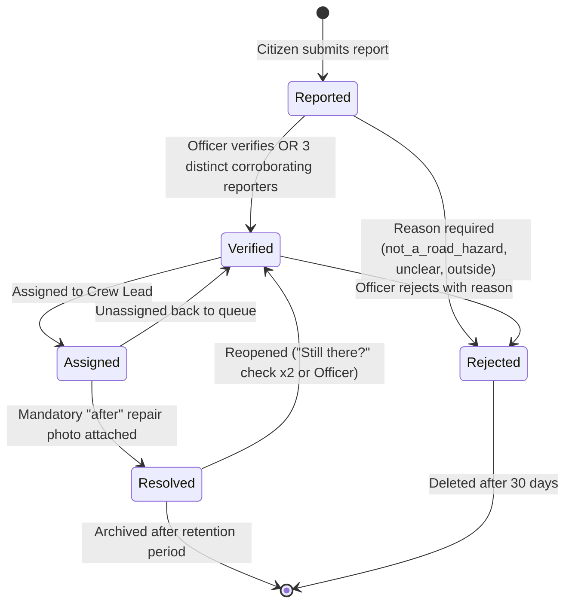
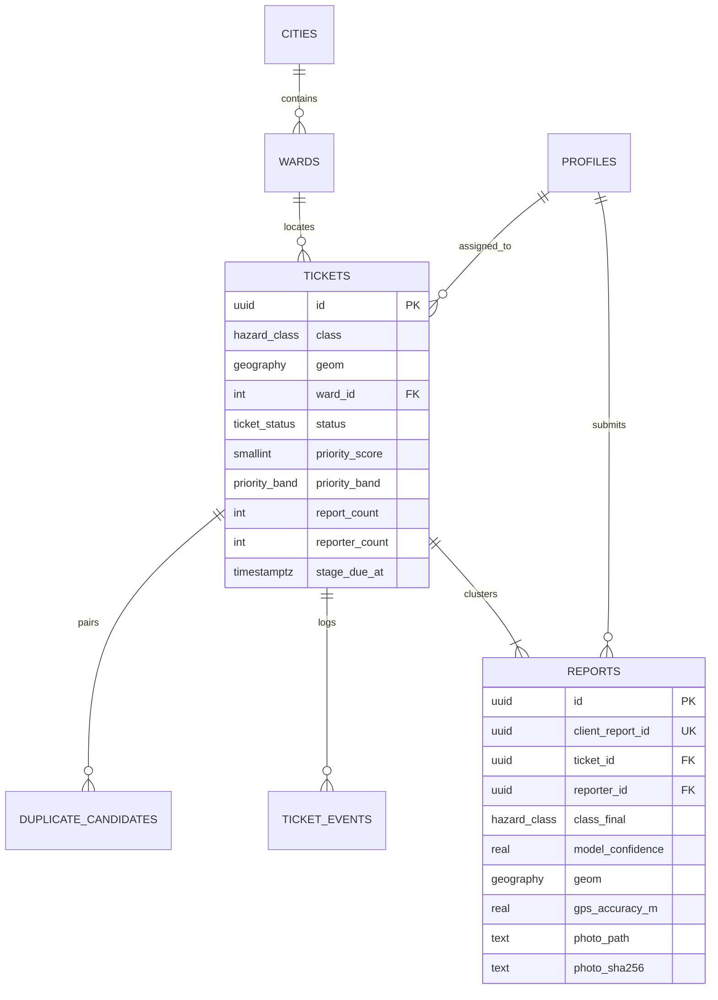

# CivicSync System Architecture
Version: 1.0-rc1 · Date: 28 Oct 2026

## 1. High-Level Concept
The citizen's mobile device performs the tasks that require **zero latency and offline resilience**:
- Camera photo capture (<30 seconds)
- GPS acquisition with accuracy reading
- On-device AI hazard classification via TensorFlow Lite (MobileNetV2 INT8)
- On-device privacy protection (face and vehicle license plate blurring)
- Local SQLite queue (`drift`) with idempotent sync

The cloud infrastructure (Supabase + PostGIS) performs tasks requiring **global municipal context**:
- Spatial point-in-polygon ward assignment
- Duplicate hazard grouping and auto-merging (25m / 50m)
- OpenStreetMap feature proximity lookup (schools, hospitals, primary transit arteries)
- Deterministic Priority Scoring (0–100) and SLA tracking
- Push notifications via Firebase Cloud Messaging

The municipal dashboard (Flutter Web / Modern Web) enables **human decision-making and triage**:
- Ranked priority queue (Critical, High, Medium, Low)
- ST_SnapToGrid 250m density clustering
- Duplicate merge/split review
- Status transitions (`Reported` → `Verified` → `Assigned` → `Resolved` with mandatory after-photo verification)

---

## 2. Status Workflow State Machine

---

## 3. Database Schema Overview

