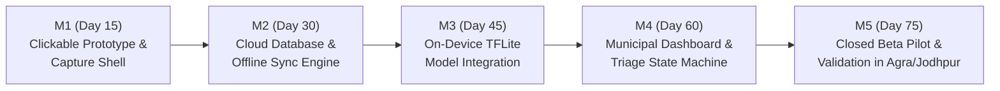

# CivicSync 75-Day Roadmap: Prototype to Validated Pilot
Version: 1.0-rc1 · Date: 28 Oct 2026 · Assumes Day 1 = 29 Oct 2026

---

## Sprint Breakdown

### Sprint 1: Design & App Shell (Days 1–15, 29 Oct – 12 Nov) $\rightarrow$ **Gate M1**
- [x] Wireframes and UX flows for capture, confirm, thanks, and my reports.
- [x] Flutter mobile application shell with one-tap camera capture.
- [x] GPS location capture with accuracy threshold tagging and low-GPS warnings.
- [x] English and Hindi string files integrated from Day 1.
- [x] 18+ age verification and privacy agreement gate.
- [ ] Field photo collection across Agra and Jodhpur; annotation with Label Studio.

### Sprint 2: Database & Backend (Days 16–30, 13 Nov – 27 Nov) $\rightarrow$ **Gate M2**
- [x] PostgreSQL + PostGIS schema, spatial indexes, and Row-Level Security policies.
- [x] Atomic `submit_report` RPC with coarse-grid advisory locking.
- [x] Duplicate clustering logic (25m auto-merge, 50m candidate review).
- [ ] Drift SQLite offline database and WorkManager sync engine.
- [ ] Pilot ward boundary GeoJSON imports for Agra and Jodhpur.
- [ ] OpenStreetMap context features ingestion script.

### Sprint 3: AI Training & Optimization (Days 31–45, 28 Nov – 12 Dec) $\rightarrow$ **Gate M3**
- [x] MobileNetV2 transfer learning pipeline with focal loss and class weighting.
- [x] Post-training INT8 quantization to `.tflite` ($\le$ 5 MB file size budget).
- [x] Inference benchmark gate ($p95 < 150\text{ ms}$ on Snapdragon 680 reference device).
- [x] Day 40 fallback decision rule (5 classes vs 3 classes based on Macro-F1 $\ge$ 0.75).
- [ ] Integration of `tflite_flutter` into the Flutter mobile application.

### Sprint 4: Municipal Dashboard & SLA Engine (Days 46–60, 13 Dec – 27 Dec) $\rightarrow$ **Gate M4**
- [x] Web dashboard shell with role-based switching (Ward Officer, Crew Lead, City Admin).
- [x] Ranked priority queue ordered by deterministic Priority Score.
- [x] Fast Lane 1-click verification strip.
- [x] "Why this rank?" plain-language explanation generator.
- [x] Ticket transition workflow (`Reported` $\rightarrow$ `Verified` $\rightarrow$ `Assigned` $\rightarrow$ `Resolved` with after-photo).
- [ ] ST_SnapToGrid density cell map layer.
- [ ] Automated SLA escalation jobs and push notifications via FCM.

### Sprint 5: Beta Pilot & Final Validation (Days 61–75, 28 Dec – 11 Jan) $\rightarrow$ **Gate M5**
- [ ] Closed beta rollout: 40+ commuters across Agra and Jodhpur; 200+ live reports.
- [ ] Post-beta surveys on citizen clarity and response time satisfaction.
- [ ] Review duplicate merge accuracy ($\ge$ 90% target) with municipal officers.
- [ ] Final demo video, results dossier, and documentation package for challenge judges.
